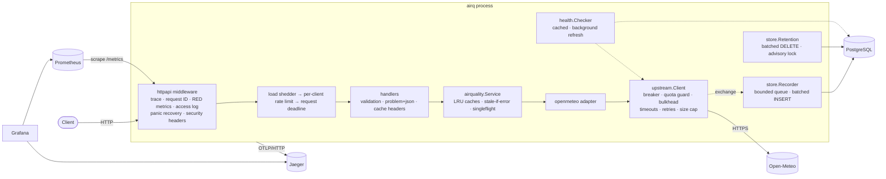

# Architecture

airq is a single stateless Go service in front of the Open-Meteo Air Quality and
Geocoding APIs. Its job is to answer air quality questions quickly and predictably,
even when its dependencies do not cooperate.

**Goals:**
- Bounded latency for every request.
- Correct HTTP caching semantics.
- Graceful degradation when the vendor or the database fails.
- An audit trail of every vendor exchange.
- Enough telemetry to explain any request after the fact.

**Non-goals (for now):**
- Authentication.
- A shared cache across replicas.
- Exactly-once audit logging.

[ADRs](adr) explain why, and [Operations](OPERATIONS.md) covers the follow-ups.

## Components



| Package | Responsibility |
|---|---|
| `cmd/airq` | Wiring, configuration, lifecycle (startup, graceful shutdown), subcommands (`serve`, `migrate`, `healthcheck`, `version`) |
| `internal/httpapi` | Routing (stdlib `ServeMux`), middleware, input validation, error mapping, HTTP caching headers |
| `internal/airquality` | Domain model (AQI categories), the caching service and its freshness policy |
| `internal/openmeteo` | Vendor adapter: maps Open-Meteo JSON to the domain and back |
| `internal/upstream` | Vendor-agnostic resilient HTTP client and the failure taxonomy |
| `internal/cache` | Bounded LRU with per-entry TTL and a stale window |
| `internal/store` | PostgreSQL pool, migrations (goose), audit recorder, retention |
| `internal/health` | Liveness, readiness and the health report |
| `internal/telemetry` | slog JSON logging with trace correlation, Prometheus registry, OpenTelemetry setup |
| `internal/config` | Typed environment configuration with cross-field validation |
| `internal/mockvendor` | Open-Meteo emulator with runtime fault injection (tests, CI, chaos drills) |

Dependencies point inward:
- `httpapi` depends on an `airquality.Service` interface.
- `airquality` depends on a `Provider` interface that `openmeteo` implements.
- `upstream` knows nothing about air quality.

Handlers are tested with a fake service, and the service with a fake provider.

## Request lifecycle

Take `GET /v1/air-quality/london` as an example.

1. **Server span and request context.** `otelhttp` starts a server span. An incoming
   `traceparent` becomes the parent only with `HTTP_TRUST_PROXY_HEADERS=true`; otherwise
   it becomes a link, so external callers cannot join or poison our traces. The
   request ID comes from `X-Request-ID` if present, else the trace ID. It is echoed in
   the response and attached to every log line.
2. **Observe.** The route *pattern* (`/v1/air-quality/{location}`, never the raw path)
   labels the RED metrics, which keeps cardinality bounded. Latency carries a trace
   exemplar. One structured access log line is written per request.
3. **Protect** (API routes only; probes and `/metrics` are exempt so they keep working
   under overload):
   - **Load shedder:** above `HTTP_MAX_IN_FLIGHT` concurrent requests it answers `503` at
     once rather than queueing. Queueing only converts overload into timeouts.
   - **Per-client token bucket**, keyed by client IP and held in a bounded LRU of
     10,000 clients, so memory is fixed: `429` with `Retry-After`.
   - **Request deadline** (`HTTP_REQUEST_TIMEOUT`, 10s). Everything downstream, retries
     included, must finish inside it.
4. **Validate.** Place names are length- and character-checked. Coordinates are range-checked and
   rounded to 2 decimals (about 1.1 km, still finer than the about 11 km CAMS model grid)
   so nearby requests share cache entries. Errors come back as `problem+json` with
   per-field messages.
5. **Resolve** the place through the geocode cache (24h; misses cached for 10m as a
   negative cache) and fetch current conditions through the current cache (10m).
6. **On a miss**, `singleflight` coalesces identical concurrent fetches into one vendor
   call. The shared fetch runs detached from any single caller's cancellation, bounded
   by its own timeout, so one impatient client cannot fail everyone waiting on it.
7. **The upstream client** runs up to `UPSTREAM_MAX_ATTEMPTS` attempts:
   1. **Circuit breaker** (`gobreaker`): when open, it fails fast with `Retry-After` set
      to the time left until the half-open probe.
   2. **Quota guard** (`x/time/rate`, 5 rps): protects the vendor's fair-use limits
      across all callers.
   3. **Bulkhead** (`semaphore`, 16 per upstream): a slow vendor cannot absorb every
      goroutine and connection.
   4. **The HTTP attempt**, with its own deadline (3s). The body is capped at 1 MiB
      and must decode as JSON into typed values. The URL recorded in spans has the API key stripped. No trace
      headers are sent to the vendor.
   5. **Classification** into a `Kind`. Retryable kinds are timeout, network, 429 and
      5xx; a 429's `Retry-After` is honoured, capped at 2 minutes. Retries use exponential backoff with
      randomised (±50%) backoff and never sleep past the request deadline. Client errors (4xx) and
      caller cancellations never trip the breaker.
8. **Every attempt is handed to the recorder** (non-blocking, see below), whatever its outcome.
9. **Respond.** The response carries `ETag`, `Cache-Control: max-age` (the remaining
   TTL), `Age`, `X-Cache` and `Cache-Status`. `http.ServeContent` answers
   `If-None-Match` with `304` and handles `HEAD`.
10. **If the vendor fails** and an expired entry is still inside its stale window
    (`CACHE_STALE_FOR`, 1h), that entry is served with `X-Cache: STALE` and
    `Cache-Control: no-cache`. Otherwise the error is mapped to a stable code:
    - `503` with `Retry-After` when the circuit is open or the request was throttled;
    - `504` on timeout;
    - `502` for other vendor failures.

    Vendor error details are logged, never returned.

## Caching

| Cache | Key | TTL | Why that TTL |
|---|---|---|---|
| Current conditions | rounded lat,lon | 10m | CAMS data updates hourly; 10m bounds staleness while absorbing bursts |
| Forecast | rounded lat,lon | 30m | Forecast runs change a few times a day. The full 96h is fetched once and sliced per request, so `hours` does not fragment the cache. |
| Geocoding | name + country | 24h | Place coordinates do not move |
| Geocoding misses | name + country | 10m | Stops repeated lookups of misspelled names |

Every cache is an LRU bounded by `CACHE_MAX_ENTRIES`, so memory stays fixed whatever
clients send. Entries expire lazily, stay servable for `CACHE_STALE_FOR` past expiry
while the vendor is failing, and are then evicted.

**In-process vs Redis.** Each replica has its own cache. That gives no network hop,
nothing extra to operate, and no new failure mode. The cost is a lower hit ratio with
many replicas and per-replica vendor load after a deploy. At this data size (a few KB
per entry, a small key space) that is the right trade. A shared cache becomes worth it
when the vendor quota, not latency, is the binding constraint ([ADR 0003](adr/0003-caching.md)).

## Resilience

Timeouts are layered so that an inner deadline always fires before the outer one:

```
HTTP server   ReadHeader 5s · Read 10s · Write 30s · Idle 120s · MaxHeaderBytes 16 KiB
 └ request    HTTP_REQUEST_TIMEOUT 10s  (includes retries and backoff)
    └ attempt UPSTREAM_ATTEMPT_TIMEOUT 3s × up to 3 attempts, backoff 100ms…1s, budgeted
DB            statement_timeout = lock_timeout = 5s; recorder writes bounded by the same
Health        each check 1s; results cached 2s; refreshed every 15s in the background
Shutdown      readiness fails → drain 5s → in-flight deadline 20s → flush recorder → flush traces
```

| Mechanism | Protects against | Where |
|---|---|---|
| Server timeouts, header size cap | Slowloris, oversized headers | `cmd/airq` |
| Load shedding (`HTTP_MAX_IN_FLIGHT`) | Overload turning into timeouts for everyone | `httpapi` |
| Per-client rate limit | One client starving others | `httpapi` |
| Request deadline | Unbounded work per request | `httpapi` |
| Request coalescing | Cache stampede on popular keys | `airquality` |
| Stale-if-error | Vendor outages reaching clients | `airquality`, `cache` |
| Retries with jittered backoff, deadline-budgeted | Transient vendor and network failures, without retry storms | `upstream` |
| Circuit breaker | Hammering a failing vendor; slow failures | `upstream` |
| Bulkhead | A slow vendor consuming all goroutines and sockets | `upstream` |
| Outbound quota guard | Exceeding the vendor's fair-use limit, getting blocked | `upstream` |
| Response size cap | Memory blow-up from a misbehaving vendor | `upstream` |
| Async, bounded audit recorder | The database slowing or failing API requests | `store` |
| Panic recovery | One bad request killing the process | `httpapi` |
| Graceful shutdown with a drain period | Dropped requests during deploys | `cmd/airq` |
| Container memory limit + `GOMEMLIMIT` | GC thrash and OOM kills | `compose.yaml` |

### Health semantics

There are three endpoints, and they answer three different questions ([ADR 0006](adr/0006-health-semantics.md)):

- `/livez` asks whether the process can serve HTTP. It never checks dependencies:
  restarting a pod does not fix a database outage, and doing so turns a blip into a
  restart storm.
- `/readyz` asks whether the load balancer should send traffic here. It fails while
  draining, or when a *critical* check fails. **No dependency is critical:** with the
  vendor down the service still serves cached data, and with the database down it only
  loses audit rows. Taking every replica out of rotation would turn a partial outage
  into a total one.
- `/health` gives the per-check report: `ok`, `degraded` (a soft dependency is failing)
  or `down`. It is public, so failing checks show only `timeout` or `unavailable`. The
  raw error is logged on each state change and served on the private admin listener.

Health results are cached for 2s and refreshed in the background, so aggressive
probing cannot amplify into dependency load, and the `airq_health_check_up` gauge
stays current for alerting even when nothing is polling.

## Persistence

The PostgreSQL schema is a single append-only audit table, `upstream_responses`: one
row per vendor attempt, including retries and failures. It holds the request ID, the
upstream and endpoint, the query (credentials never stored), the status, the outcome,
the duration and the JSON body. Bodies are capped at `RECORDER_MAX_BODY_BYTES`, and
`body_truncated` marks the ones dropped for size. Indexes:
- **BRIN on `created_at`:** tiny, and ideal for time-ordered appends and retention scans;
- **partial index on `request_id`:** joins a log line to its vendor calls;
- **partial index on failures:** for incident queries.

The recorder is deliberately best-effort ([ADR 0005](adr/0005-best-effort-audit-recorder.md)):

- `Record` never blocks a request. Exchanges go onto a bounded channel; when it is full
  they are dropped and counted (`airq_recorder_records_total{result="dropped"}`).
- Bodies are copied into the queue only if small enough, so a stalled database cannot
  pin vendor responses in memory: the queue's worst case is bounded by
  `RECORDER_BUFFER × RECORDER_MAX_BODY_BYTES`.
- A single writer goroutine batches rows into multi-row `INSERT`s (`RECORDER_BATCH_SIZE`
  rows, or every `RECORDER_FLUSH_INTERVAL`). A batch that fails on bad data is retried
  row by row, so one bad row cannot lose its neighbours.
- On shutdown the queue is drained and flushed within a bounded time.

The retention job deletes rows older than `DB_RETENTION` in batches, so no single
statement holds locks or generates WAL for long. It runs under `pg_try_advisory_lock`,
so with several replicas exactly one does the work and the rest record `skipped`. At
higher volume, time partitioning (dropping partitions instead of deleting rows) is the
next step.

### Migrations and roles

Migrations are plain SQL files embedded in the binary and applied by goose
([ADR 0008](adr/0008-migrations-and-database-roles.md)):

- Each migration runs in a transaction. Postgres has transactional DDL, so a failed
  migration rolls back cleanly instead of leaving a "dirty" state.
- `-- +goose NO TRANSACTION` is available for `CREATE INDEX CONCURRENTLY`.
- A session-level advisory lock serialises concurrent runners.
- Files are append-only (`NNNNNN_name.sql`), enforced by CI. Schema changes follow
  expand/contract so that old and new releases run against the same schema during a
  rolling deploy.

Migrations run as a **separate one-shot step** (the `migrate` compose service, or a
Kubernetes Job or init container), not inside the service. The roles split
responsibilities:

| Role | Owns / may | Used by |
|---|---|---|
| `postgres` | superuser | first-time initialisation only (`deploy/postgres/initdb`) |
| `airq_migrator` | owns the schema; DDL | `airq migrate` |
| `airq_app` | `SELECT`, `INSERT`, `DELETE` on `upstream_responses`; `SELECT` on the migration table; nothing else | the service |

The service cannot alter the schema, update audit rows or touch migration state. The
smoke test verifies each of these denials against the real database. `DB_MIGRATE_ON_START`
exists for single-instance setups that accept running DDL with the service role.

## Observability

([ADR 0007](adr/0007-observability.md))

- **Metrics** use Prometheus `client_golang` on a private registry:
  - RED metrics per route;
  - cache hit, miss, stale, coalescing and eviction counts;
  - upstream calls, attempts, retries, breaker state and transitions, bulkhead
    occupancy, quota waits and connection reuse;
  - DB query latency by operation, plus `database/sql` pool stats;
  - recorder and retention counters;
  - health gauges and build info.

  Histograms carry trace-ID exemplars, so a latency spike in Grafana links to the
  trace. The full catalogue is in [Operations](OPERATIONS.md#metrics-catalogue).
- **Traces** use OpenTelemetry, exported over OTLP/HTTP when `OTEL_EXPORTER_OTLP_ENDPOINT`
  is set:
  - a server span per request;
  - a logical span per vendor call, with a child client span per attempt;
  - pgx query spans.

  Background work (recorder batches, retention runs) starts its own root traces, with
  links back to the requests it serves. Long-lived workers therefore never produce
  hour-long traces.
- **Logs** are JSON `slog` on stdout. Every line in a request carries `request_id`,
  `trace_id` and `span_id`. There is one access log line per request, with the query
  reduced to known parameters. Failed vendor attempts are logged with the full error,
  which clients never see.
- **SLOs:** 99.5% of API requests succeed over 30 days, and 99% complete within 1s.
  Multi-window, multi-burn-rate alerts sit on recording rules, and promtool unit tests
  cover the alerts.

## Deployment

Locally, `compose.yaml` runs airq, a one-shot `migrate`, PostgreSQL, Prometheus,
Grafana and Jaeger:
- every service is pinned by digest;
- airq runs read-only, with all capabilities dropped and `no-new-privileges`;
- limits: 1 CPU, 256 MiB with `GOMEMLIMIT=200MiB`, and 256 pids.

`compose.mock.yaml` swaps the vendor for the emulator.

In production, the same image runs as a Deployment:
- **probes:** `livenessProbe` → `/livez`, `readinessProbe` → `/readyz`;
- **migrations:** the `migrate` subcommand runs as a pre-deploy Job using the migrator
  credentials;
- **shutdown:** `terminationGracePeriodSeconds` must cover `HTTP_DRAIN_DELAY +
  HTTP_SHUTDOWN_TIMEOUT` plus a few seconds;
- **multiple replicas:** caches, rate limits and quota guards are per replica, so
  limits should be set per replica. Retention is coordinated through the advisory lock.

## Decisions

| ADR | Decision |
|---|---|
| [0001](adr/0001-dependency-policy.md) | Dependency policy, and the full built-vs-borrowed inventory |
| [0002](adr/0002-open-meteo-vendor.md) | Open-Meteo as the vendor, behind a provider interface |
| [0003](adr/0003-caching.md) | In-process LRU caches with stale-if-error and request coalescing |
| [0004](adr/0004-upstream-resilience.md) | Layered upstream resilience: deadline-budgeted retries, breaker, bulkhead, quota guard |
| [0005](adr/0005-best-effort-audit-recorder.md) | Asynchronous, best-effort audit logging to PostgreSQL |
| [0006](adr/0006-health-semantics.md) | Health semantics: no critical dependencies, degraded instead of not-ready |
| [0007](adr/0007-observability.md) | Prometheus metrics, OpenTelemetry traces, JSON logs, SLO burn-rate alerts |
| [0008](adr/0008-migrations-and-database-roles.md) | goose migrations as a separate step with least-privilege roles |
